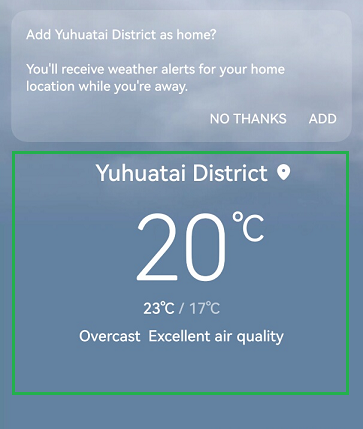

# Multi-Component Scenarios

## Scenario Design

A functionally complete UI object may be formed by several UI components. If each component can be focused and read, information redundancy and efficiency reduction may occur. And too many focusable components of a UI object compromise the performance of focusing during navigation by touch. In such cases, it is more reasonable and efficient to functionally or semantically aggregate these components into a natural group and use the group as an independent focusable UI element to express content to visually impaired users. The general principle is as follows: Multiple components that represent the same object information need to be combined and labeled to expose only one accessibility focus.



## Development Examples

As shown in the following code, you can combine multiple components into a group and set a read label for the group to achieve the entire-group reading effect. The child components in the group must be set to unfocusable.

```typescript
@Entry
@Component
export struct Rule_2_1_4 {
  title: string = 'Rule 2.1.4'

  build() {
    NavDestination() {
      Column() {

        Row() {
          // By default, only the child component can be focused.
         // Information such as the date, weather, and temperature is read separately when the corresponding component is focused independently.
         // It does not follow the component group specifications.
          Text("23 Dec 2023") // Date information is read separately when the component is focused independently.
            .fontSize(32)
            .fontColor(Color.Red)
            .fontWeight(FontWeight.Bold)
            .textAlign(TextAlign.Center)
            .margin({ right: 20 })

          Column() // Weather information is read separately when the component is focused independently.
            .backgroundColor(Color.Blue)
            .width(50)
            .height(50)
            .accessibilityText("Snow") // This text is read when the component is selected by Screen Reader, because the component does not contain any text information.
            .margin({ right: 20 })

          Text("-1") // Temperature information is read separately when the component is focused independently.
            .fontSize(20)
            .fontColor(Color.Green)
            .fontWeight(FontWeight.Bold)
            .textAlign(TextAlign.Center)
        }
        .height(50)
        .margin({ bottom: 20 })

        Row() {
          // The child component cannot be focused because the accessibilityGroup attribute is set to true.
          // When the grouped component is focused, the date, weather, and temperature information is read together.
         // In this case, only the Row component can be focused, which complies with the component group specifications.
          Text("24 Dec 2023") // Date information. This component cannot be focused and read because the accessibilityGroup attribute of the parent component is set to true.
            .fontSize(32)
            .fontColor(Color.Red)
            .fontWeight(FontWeight.Bold)
            .textAlign(TextAlign.Center)
            .margin({ right: 20 })

          Column() // Weather information. This component cannot be focused and read because the accessibilityGroup attribute of the parent component is set to true.
            .backgroundColor(Color.Yellow)
            .width(50)
            .height(50)
            .accessibilityText("Sunny") // When the component is selected by Screen Reader and it does not contain any text information, the accessibility text is read.
            .margin({ right: 20 })

          Text("-7") // // Temperature information. This component cannot be focused and read because the accessibilityGroup attribute of the parent component is set to true.
            .fontSize(20)
            .fontColor(Color.Green)
            .fontWeight(FontWeight.Bold)
            .textAlign(TextAlign.Center)
        }
        .height(50)
        .margin({ bottom: 20 })
        .accessibilityGroup(true) // Set accessibilityGroup to true.
      }
      .alignItems(HorizontalAlign.Start)
      .padding(10)
    }
    .title(this.title)
  }
}
```
