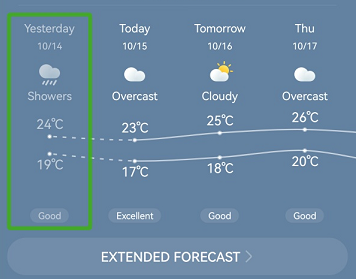

# Screen Reading Scenarios of Illustrations/Videos/Animations

## Development Example 1

As shown in the following figure, an illustration functions as a certain prompt, which should be combined with the corresponding function description so that the function description is read when the focus falls on the illustration or the component that contains the illustration. It is recommended that illustrations and function descriptions be combined and share a single focus for reading. This scenario can be implemented by using the **accessibilityGroup(true)** attribute.


```typescript
@Entry
@Component
export struct Rule_2_1_6_1 {
  title: string = 'Rule 2.1.6.1'
  private description: string = 'gesture swipe left then up'

  build() {
    NavDestination() {
      Column() {
        Flex({
          direction: FlexDirection.Column,
          alignItems: ItemAlign.Center,
          justifyContent: FlexAlign.Center,
        }) {
          Column() {
            Image($r("app.media.gesture_swipe_left_then_up"))
              .width(220)
              .height(220)
            Text(this.description)
              .fontSize(22)
              .fontColor(Color.Red)
              .fontWeight(FontWeight.Bold)
              .textAlign(TextAlign.Center)
          }.accessibilityGroup(true) // Group the image and text as a single accessibility object.
        }
        .width('100%')
        .height('100%')
        .backgroundColor(Color.White)
      }
    }
    .title(this.title)
  }
}
```

## Development Example 2

Each item in the following list should be grouped and annotated to provide a complete prompt for users.

* All items in a **List** or **Grid** component must be annotated together by default.

* Each item in a **List** or **Grid** component should provide all information about the elements contained.

* Reading the combination information about all nested elements of each item in a list is recommended.

  

  This scenario can be implemented by using the **accessibilityGroup(true)** attribute.

  ```typescript
  @Entry
  @Preview
  @Component
  export struct Rule_2_1_6_2 {
    title: string = 'Rule 2.1.6.2'

    build() {
      NavDestination() {
        Flex({
          direction: FlexDirection.Column,
          alignItems: ItemAlign.Center,
          justifyContent: FlexAlign.Center,
        }) {
          Column() {
            Item_2_1_6_3({
              title: 'Video card',
              subtitle: 'provided with options',
              time: '1:23 hrs',
              color: '#ffdee5ff'
            })
            Item_2_1_6_3({
              title: 'Music card',
              subtitle: 'sound feedback available',
              time: '2:75 min',
              color: '#92e1ffd8'
            })
            Item_2_1_6_3({
              title: 'Live card',
              subtitle: 'health support on request',
              time: '10:55',
              color: '#fff3deff'
            })
            Item_2_1_6_3({
              title: 'Play card',
              subtitle: 'play station tournament',
              time: '5:12 hrs',
              color: '#92e1ffd8'
            })
            Item_2_1_6_3({
              title: 'Theater card',
              subtitle: 'ticket on concert',
              time: '2:75 min',
              color: '#ffdee5ff'
            })
          }
        }
      }.title(this.title)
    }
  }

  @Component
  export struct Item_2_1_6_3 {
    title: string = 'Video card'
    subtitle: string = 'provided with additional options'
    time: string = '1:23 hr'
    color: ResourceColor = "#80FAFAFA"

    build() {
      Flex({
        direction: FlexDirection.Row,
        alignItems: ItemAlign.Center,
        justifyContent: FlexAlign.SpaceBetween,
      }) {
        Column() {
          Text(this.title)
            .fontSize(22)
            .fontWeight(FontWeight.Bold)
            .textAlign(TextAlign.Center)
            .padding({ left: 20, right: 0 })
          Text(this.subtitle)
            .fontSize(14)
            .fontColor(Color.Gray)
            .fontWeight(FontWeight.Normal)
            .textAlign(TextAlign.Center)
            .padding({ left: 20, right: 0 })
        }

        Column() {
          Text(this.time)
            .fontSize(20)
            .fontWeight(FontWeight.Normal)
            .textAlign(TextAlign.Center)
            .padding({ left: 10, right: 10 })
        }

        Column() {
          Image($r("app.media.ic_arrow")) // Replace the image resource with a local one.
            .width(28)
            .height(28)
            .fillColor(Color.Gray)
        }.align(Alignment.End)

      }
      .width('90%')
      .height(75)
      .border({
        width: 1,
        color: '#FFC0C0C0',
        radius: 8,
        style: {
          top: BorderStyle.Solid,
        }
      })
      .backgroundColor(this.color)
      .accessibilityGroup(true) // combines text and image into single object
      .margin({ top: 10 })
    }
  }
  ```
